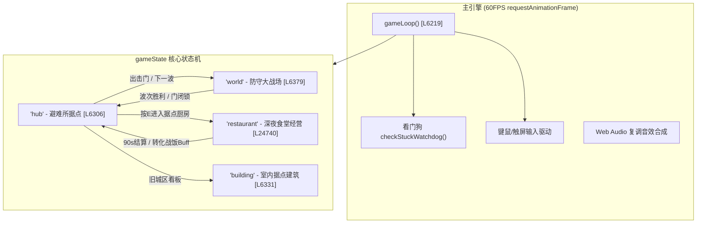
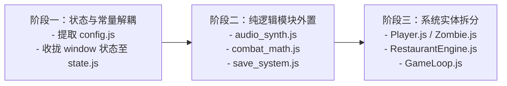

# 《十五波围城：最后据点 v55》系统架构脑图与代码速查字典

> **文档定位**：针对单文件 HTML5 游戏工程 `zombie-game-v55.html`（共 29,370 行代码，含近 2.7 万行核心 JavaScript 引擎）的系统级架构剖析、核心函数速查索引与代码隐患诊断，为后续的功能扩展、重构解耦与安全修改提供全景技术指南。

---

## 目录
1. [代码全景与物理文件分布](#1-代码全景与物理文件分布)
2. [宏观系统架构与状态机流转](#2-宏观系统架构与状态机流转)
3. [六大核心子系统全景剖析](#3-六大核心子系统全景剖析)
4. [核心函数与全局对象速查字典](#4-核心函数与全局对象速查字典)
   - [4.1 玩家与实体系统 (Player & Entities)](#41-玩家与实体系统-player--entities)
   - [4.2 武器战斗与伤害结算 (Combat & Ballistics)](#42-武器战斗与伤害结算-combat--ballistics)
   - [4.3 敌人AI、Boss与波次调度 (AI, Boss & Director)](#43-敌人ai-boss与波次调度-ai-boss--director)
   - [4.4 避难所据点与旧城远征 (Shelter & Expedition)](#44-避难所据点与旧城远征-shelter--expedition)
   - [4.5 深夜食堂经营系统 (Night Restaurant Engine)](#45-深夜食堂经营系统-night-restaurant-engine)
   - [4.6 界面HUD、音频与存档系统 (UI, Audio & Persistence)](#46-界面hud音频与存档系统-ui-audio--persistence)
5. [代码隐患与性能瓶颈诊断 (Health & Bottleneck Audit)](#5-代码隐患与性能瓶颈诊断-health--bottleneck-audit)
6. [后续模块化拆分与重构路线建议](#6-后续模块化拆分与重构路线建议)

---

## 1. 代码全景与物理文件分布

文件 `zombie-game-v55.html` 大小约为 1.45 MB，共 29,370 行。代码在物理结构上高度集中但逻辑分块清晰，整体划分为以下六大 Block：

| 区块标识 | 起止行号区间 | 代码行数 | 核心职责与包含内容 |
| :--- | :--- | :--- | :--- |
| **HTML & CSS** | L1 – L2617 | ~2,617 行 | 页面根样式、Dave the Diver 暖色调主题 Token、游戏 HUD、各子系统模态弹窗（军械所、指挥所、餐厅、天赋胶囊、图鉴、暂停界面等） |
| **Block 01: CONFIG & REGISTRIES** | L2618 – L3870 | ~1,253 行 | 全局物理/世界常量、画布 Hi-DPI 初始化、武器注册表 `WEAPONS`、武器进化分支、塔防类型、僵尸图鉴、菜谱配方、六大流派定义 |
| **Block 02: CORE ENGINE & INPUT** | L3871 – L7258 | ~3,388 行 | Web Audio API 过程化复调音效合成器、键鼠/触屏虚拟摇杆输入监听、粒子池与视觉抖动、主游戏循环 `gameLoop()`、看门狗检测 |
| **Block 03: COMBAT & DEFENSE** | L7259 – L17767 | ~10,509 行 | 小胡角色多层绘制 `drawPlayer`、枪械/双持射击与弹道物理、高地哨塔防卫、近战挥砍、僵尸状态机 AI、Boss 阶段机制、碰撞与受击流血结算、15 波次刷怪调度 |
| **Block 04: SHELTER & EXPEDITION** | L17768 – L20499 | ~2,732 行 | 白天据点 Hub 场景、避难所设施交互（床铺、扭蛋机、防线加固、出击门）、NPC 剧情对话（张/林/强/赵）、战术工坊与旧城区远征副本 |
| **Block 05: RESTAURANT SYSTEM** | L20500 – L27040 | ~6,541 行 | 模仿《潜水员戴夫》的深夜食堂经营状态机、今晚菜单注册制、顾客进店排队/选座/耐心衰减、烹饪 QTE、芥末/酒水补给、网红/美食家事件、收益结算与战斗增益传递 |
| **Block 06: UI & PERSISTENCE** | L27041 – L29370 | ~2,330 行 | 飘字粒子、顶部战况横幅、战场 HUD 实时渲染、肉鸽天赋三选一、LocalStorage 自动存档、JSON 文件导入导出、自解包导出下载、初始化启动入口 |

---

## 2. 宏观系统架构与状态机流转

游戏通过主状态机变量 `gameState` 控制不同玩法模式间的切换，形成了**白天防守/据点整备 ↔ 夜晚食堂经营/远征搜刮**的双循环闭环。

### 数据交互与流转闭环
1. **战斗阶段 (`gameState === 'world'`)**：击杀僵尸掉落各品类肉块（普通肉、瘦肉、厚肉、异变肉）、金币与改装配件。
2. **据点缓冲 (`gameState === 'hub'`)**：可在基地加固城墙、维修机枪塔、与 NPC 交流、分配装备。
3. **经营阶段 (`gameState === 'restaurant'`)**：消耗战斗搜集的肉块制作菜品招待顾客，赚取巨额金币、提升社媒声望，并生成次日生效的战斗特餐增益（`queuedBattleBuffs` / `activeBattleBuffs`）。
4. **属性反哺**：经营利润用于升级军火库与天赋，强化战斗能力迎战更强波次与 Boss。

---

## 3. 六大核心子系统全景剖析

### 3.1 坐标与渲染管线体系 (L2641 - L2662)
- **世界三屏划分**：总宽 `WORLD_W = 2520`，高度 `GH = 500`。
  - 左屏（0 ~ 800）：家园防线、城堡与哨塔安全区。
  - 中屏（800 ~ 1700）：主力战场、壕沟与路障。
  - 右屏（1700 ~ 2520）：旧小镇废墟、搜刮点与广播塔剧情终点。
- **高清视网膜渲染**：通过 `_DPR = Math.min(2, window.devicePixelRatio || 1)` 动态放大物理像素画布，逻辑坐标统一保持 1100×500，使用 `ctx.scale(_DPR, _DPR)` 实现零适配成本的高清渲染。

### 3.2 武器与双持战斗生态 (L2669 - L2750, L15504 - L16047)
- **槽位机制**：严格限定 `MAX_OWNED_WEAPONS = 2` 双持生态（按数字键 1/2 或滚轮快速切枪）。
- **品质划分**：制式自卫（⚪白）、战术军规（🔵蓝）、特种重火（🟣紫）、神兵专属（🔴红）。
- **进化与变异**：`WEAPON_EVOLUTIONS` 支持力量专精与特性异化两大方向，赋予武器穿透、弹跳、冰爆、破甲与集束爆破机制。

### 3.3 敌人 AI 与波次生成系统 (L9405 - L10750, L15256 - L17600)
- **僵尸行为树**：巡逻 -> 索敌 -> 追逐小胡 -> 遇到城墙/路障转为啃咬攻击 -> 狂暴加速。
- **精英与 Boss 机制**：包含自爆怪、毒液吐息怪、护甲装甲怪；Boss（如暴君）具备冲撞、地震波发射、召唤小怪与阶段霸体护盾。
- **动态波次调度 (`updateWaveSpawning`)**：第 1 至 15 波根据曲线动态调整怪物密度、生成间隔以及天气环境事件（如雷暴之夜、酸雨腐蚀）。

### 3.4 避难所据点与旧城远征 (L17768 - L20499)
- **Hub 站点交互**：包含床铺深度冥想、深夜食堂木门、扭蛋机盲盒、工事军械管理、远征任务板及出击门。
- **远征副本**：在旧城区随机生成废弃诊所、战术军械所等探险地图，采用轻度迷雾搜刮机制。

### 3.5 潜水员戴夫风深夜食堂 (L20500 - L27040)
- **独立循环 `restLoop`**：脱离主世界 `gameLoop`，由专用 RAF 驱动独立的 1100×440 餐厅画布。
- **精细化经营机制**：涵盖芥末研磨（`restWasabi`）、酒水倒注（`restDrinks`）、顾客耐心计时条、员工自动送餐与清扫、网红评论家突访好评加权。

### 3.6 状态持久化与存档体系 (L28575 - L28790)
- **双轨存档**：支持每波通关自动存入 `localStorage.setItem('zombie_game_autosave')`，以及手动点击导出 `zombie_game_save.json` 文件。
- **深度状态快照**：覆盖 50+ 项运行时状态字段，包括玩家流派、武器配件、各食材存量、员工等级与剧情推进 Flag。

---

## 4. 核心函数与全局对象速查字典

### 4.1 玩家与实体系统 (Player & Entities)

| 函数 / 对象名 | 所在行号区间 | 输入参数 | 返回类型 | 核心职责说明 | 关键下游/依赖 |
| :--- | :--- | :--- | :--- | :--- | :--- |
| `player` (对象) | L2656 – L2662 等 | 全局状态 | `Object` | 记录玩家坐标 `x/y`、速度 `vx/vy`、朝向、无敌帧 `iframes`、护盾值与翻滚体力 | 全局物理与渲染 |
| `drawPlayer` | L7638 – L8150 | `px, py, facingR, walkT, aimA, jumping, hurtFlash, t, dodge` | `void` | 小胡角色的多图层程序化 Canvas 渲染，包含持枪姿态、枪口后坐力、换弹动画、翻滚残影 | `ctx.drawImage` / 几何渲染 |
| `updatePlayer` | L8151 – L8480 | 无 | `void` | 处理玩家水平位移、重力加速、跳跃碰撞、边缘墙体阻挡及翻滚无敌帧逻辑 | `keysDown`, `GROUND_Y` |
| `takeDamage` | L17222 – L17310 | `dmg: number` | `void` | 玩家受到伤害结算：护盾抵扣、护甲减伤、无敌帧赋予、受击红闪与屏幕暗角抖动、濒死/死亡判断 | `updateHpUI`, `endGame` |
| `updateCompanions` | L11240 – L11480 | 无 | `void` | 随从雇佣兵与机械犬/战狼的 AI 跟随、自动索敌射击与生命周期更新 | `zombies`, `mkBullet` |

---

### 4.2 武器战斗与伤害结算 (Combat & Ballistics)

| 函数 / 对象名 | 所在行号区间 | 输入参数 | 返回类型 | 核心职责说明 | 关键下游/依赖 |
| :--- | :--- | :--- | :--- | :--- | :--- |
| `fireWeapon` | L15504 – L15856 | `toX: number, toY: number` | `boolean` | 武器开火主逻辑：后坐力增加、枪口火焰触发、弹药扣减、散弹/穿透/火箭弹对象实例化生成 | `mkBullet`, `sndGun` |
| `mkBullet` | L15857 – L15960 | `x, y, vx, vy, w: Object` | `Object` | 构建子弹物理实体：初始化初速度、射程衰减、重力加速度、元素标签（燃烧/急冻/穿甲） | 加入全局 `bullets` 数组 |
| `reloadWeapon` | L15961 – L16047 | 无 | `void` | 启动武器换弹倒计时、播放弹匣掉落与复调装填音效，重置当前弹夹子弹数 | `isReloading`, `sndReload` |
| `hitZombie` | L16048 – L17159 | `z, bx, by, dmg, fromX, fromY, knockbackMult, dmgType` | `void` | **全游戏最核心战斗结算函数**：暴击判断、爆头倍率、护甲减免、元素 DoT（流血/冰冻/中毒）、受击击退与死亡解体分块 | `spawnFloatText`, `mkP`, `z.hp` |
| `explodeLogic` | L17160 – L17221 | `cx: number, cy: number, dmg: number, R: number` | `void` | AOE 范围爆炸结算：按距离平方反比衰减伤害，波及范围内的全部僵尸与建筑物 | `vfxExplosion`, `sndExplosion` |

---

### 4.3 敌人AI、Boss与波次调度 (AI, Boss & Director)

| 函数 / 对象名 | 所在行号区间 | 输入参数 | 返回类型 | 核心职责说明 | 关键下游/依赖 |
| :--- | :--- | :--- | :--- | :--- | :--- |
| `spawnZombie` | L15256 – L15420 | `archKeyOverride?: string` | `Object` | 根据当前波次配置表与权重抽取僵尸原型，初始化血量、速度、体型与掉落肉块品类 | `ZOMBIE_DEX`, 加入 `zombies` |
| `spawnZombieAt` | L9405 – L9480 | `sx: number` | `Object` | 在指定世界 X 坐标精准生成怪物（常用于事件召唤、Boss 召唤小怪） | `spawnZombie` |
| `updateBoss` | L14625 – L14790 | 无 | `void` | Boss 状态机更新：三段血量形态切换、霸体冲锋、召唤护卫群与全屏地刺技能释放 | `boss`, `bossProjList` |
| `hitBoss` | L14791 – L14980 | `dmg, bx, by, fromX, fromY, dmgType` | `void` | Boss 专属受击逻辑：装甲护盾减伤、受击反弹破片、硬直抗性与阶段转场检测 | `updateBossHpUI` |
| `updateWaveSpawning` | L17540 – L17765 | 无 | `void` | 15波次导演主循环：控制波次剩余怪物配额、刷怪计时器、波次结束判定与波次奖励结算 | `wave`, `waveInProgress` |

---

### 4.4 避难所据点与旧城远征 (Shelter & Expedition)

| 函数 / 对象名 | 所在行号区间 | 输入参数 | 返回类型 | 核心职责说明 | 关键下游/依赖 |
| :--- | :--- | :--- | :--- | :--- | :--- |
| `enterHub` | L17874 – L17983 | 无 | `void` | 战斗结束切换至据点世界：重设玩家坐标至基地床铺旁、生成基地闲逛 NPC、恢复主营地灯光 | `gameState = 'hub'` |
| `exitHub` | L17984 – L18080 | 无 | `void` | 离开避难所进入战斗世界：重设战斗相机、装填防守工事武器、开启出击门并激活下一波 | `gameState = 'world'` |
| `drawHubWorld` | L18209 – L18550 | 无 | `void` | 据点基地场景绘制：包含木质小屋内饰、工坊操作台、温馨篝火火光与避难所墙体 | `ctx`, `HUB_STATIONS` |
| `tryHubNpcTalk` | L17825 – L17873 | 无 | `boolean` | 检测玩家与基地 NPC（张教官、小林医生、阿强工匠、小赵通讯兵）的碰撞并触发闲聊冒泡 | `HUB_NPC_TALK` |
| `openExpeditionModal` | L19738 – L19790 | 无 | `void` | 打开旧城区远征看板弹窗：展示废弃医院、军备库等地点危险度、消耗与预期收益 | DOM 渲染 |
| `startExpedition` | L19791 – L19950 | `destKey: string` | `void` | 初始化旧城区副本状态，加载废墟环境与游荡者生成器 | `oldTownWanderers` |

---

### 4.5 深夜食堂经营系统 (Night Restaurant Engine)

| 函数 / 对象名 | 所在行号区间 | 输入参数 | 返回类型 | 核心职责说明 | 关键下游/依赖 |
| :--- | :--- | :--- | :--- | :--- | :--- |
| `startRestaurant` | L23717 – L23850 | 无 | `void` | 开启夜晚食堂营业：检查今晚菜单合法性、初始化 90 秒倒计时、重置顾客队列与灶台状态 | `gameState = 'restaurant'` |
| `restLoop` | L24740 – L24980 | `now: number` | `void` | **深夜食堂专用主循环**：驱动顾客移动、烹饪计时衰减、耐心掉落检测、帧间重绘 | `restRafId`, `requestAnimationFrame` |
| `drawRestaurant` | L25334 – L26120 | 无 | `void` | 餐厅像素画面渲染：吧台、餐桌、就餐幸存者表情气泡、厨师小胡颠勺与端盘动画 | `restCtx`, `REST_CANVAS_W/H` |
| `finishRestaurantNight` | L23947 – L24120 | 无 | `void` | 营业结束结算：统计净利润金币、Cooksta 评分与粉丝增量、将菜品增益打包存入战斗队列 | `queuedBattleBuffs`, `enterHub` |
| `toggleMenuRegistration`| L20540 – L20557 | `recipeId: string` | `void` | 餐厅菜单注册与卸载切换，受限于当前社交媒体等级解锁的菜品槽位数 | `tonightMenu`, `getMenuSlots` |

---

### 4.6 界面HUD、音频与存档系统 (UI, Audio & Persistence)

| 函数 / 对象名 | 所在行号区间 | 输入参数 | 返回类型 | 核心职责说明 | 关键下游/依赖 |
| :--- | :--- | :--- | :--- | :--- | :--- |
| `spawnFloatText` | L27054 – L27060 | `txt, x, y, col, isLarge` | `void` | 战场飘字：转换世界坐标至屏幕视口，生成带动画的浮动伤害与暴击文本（380ms 自动移除） | `gameWrap.appendChild` |
| `addBanner` | L27063 – L27085 | `txt: string` | `void` | 屏幕中上方顶部战况横幅公告（防刷屏去重、自动淡出） | `bannerTimer` |
| `getACtx` | L3880 – L3885 | 无 | `AudioContext` | 懒加载获取单例 Web Audio 上下文并确保处于 `running` 状态 | `window.AudioContext` |
| `noise` | L3890 – L3906 | `duration, freq, type, volStart, volEnd...` | `void` | 纯过程化合成器：无需加载任何外部音频文件，使用白噪声与多波形振荡器实时合成爆炸/枪声 | `actx.createOscillator` |
| `buildSaveState` | L28576 – L28624 | 无 | `Object` | 收集并构建完整的游戏状态快照对象，涵盖武器、金币、波次、随从、食材、经营与等级天赋 | 全局 50+ 状态变量 |
| `autoSaveToStorage` | L28627 – L28635 | 无 | `void` | 将当前游戏进度序列化并存入浏览器本地存储 `localStorage.setItem('zombie_game_autosave')` | `buildSaveState` |
| `restoreSaveState` | L28718 – L28890 | `state: Object` | `void` | 从快照对象反序列化并安全恢复所有变量状态（含版本兼容与脏数据过滤兜底） | 各子系统状态重置 |
| `continueGame` | L4923 – L4945 | 无 | `void` | 主菜单点击“继续游戏”的入口：读取 LocalStorage 存档并无缝恢复至游戏循环 | `restoreSaveState`, `gameLoop` |

---

## 5. 代码隐患与性能瓶颈诊断 (Health & Bottleneck Audit) [✅ 全部完成修复]

在系统审计过程中，针对超大单文件结构诊断出的 6 处关键隐患与瓶颈，现已在 `zombie-game-v55.html` 中全部完成修复并经集成测试验证：

### ✅ 隐患 1：毒素持续伤害中的异步 `setInterval` 泄漏风险 [已修复]
- **原问题**：每次毒液子弹命中均会启动一个独立的浏览器原生 `setInterval(..., 400)`，场景切换或怪物异常死亡时定时器易泄露。
- **修复方案**：彻底移除 `setInterval`，改为主循环帧计数器驱动（`z.poisonTimer` 每帧递减，每 24 帧触发一次伤害），游戏暂停时自然暂停，怪物死亡时自动清理。同时将燃烧 DoT 与随从三连发也一并改造为帧驱动计数器。

---

### ✅ 隐患 2：高频战斗碰撞路径下的 DOM 频繁重绘与节点积压 (DOM Thrashing) [已修复]
- **原问题**：`spawnFloatText` 每次调用都在 DOM 树中执行 `document.createElement('div')` 并插入 `gameWrap`，射速极快且敌人密集时引发严重 DOM 重排与 GC 卡顿。
- **修复方案**：完全废弃 DOM 飘字机制，实现基于 Canvas 的 256 槽位环形缓冲区对象池（`floatTextPool` / `drawFloatTexts`）。在 `drawParticles` 渲染层中直接进行 Canvas 2D 文本渲染，实现零 DOM 节点创建与零 GC 抖动。

---

### ✅ 隐患 3：挂载在全局 `window` 上的临时状态污染与生命周期失控 [已修复]
- **原问题**：存在大量 `window._xxx` 临时全局变量（如 `_groundFires`, `_berserkActive`, `_dualwieldT` 等），在重开游戏或读档时缺乏统一复位机制。
- **修复方案**：在脚本头部引入 `RuntimeBattleContext` 单例上下文管理器，集中收拢管理 30+ 运行时临时状态变量。在游戏启动（`startGame`）、读档（`restoreSaveState`）和场景切换时统一调用 `RuntimeBattleContext.reset()` 进行彻底清理。

---

### ✅ 隐患 4：单主循环全屏渐变与阴影实时计算的 GPU/Fillrate 开销 [已修复]
- **原问题**：每帧重复调用 `ctx.createRadialGradient` 重新构建 2200×1000 像素的暗角与枪口火光径向渐变对象，带来显著数学计算与 Fillrate 负担。
- **修复方案**：引入离线预渲染画布单例缓存机制（`getPvigCanvas()`, `getHvigCanvas()`, `getMuzzleLightCanvas()`），仅在初始化时生成离线渐变贴图，每帧渲染时直接通过 `ctx.drawImage` 极速合成。

---

### ✅ 隐患 5：子弹与粒子数组高频即时分配引发的 V8 Young GC 压力 [已修复]
- **原问题**：子弹和粒子每帧大量 `new` 分配并使用 `splice(i, 1)` 销毁，造成 V8 引擎新生代（Young Generation）频繁 GC 停顿。
- **修复方案**：建立子弹复用链表 `_bulletFreeList` 和粒子对象池 `_particleFreeList`。在子弹/粒子死亡时回收至池中，销毁使用 O(1) 尾部互换弹出（Swap-Pop），并为室内战斗（`updateBuildingInterior`）补齐子弹回收逻辑，杜绝 Double-Free。

---

### ✅ 隐患 6：顶层统一 Try/Catch 缺乏子系统故障隔离与状态自愈 [已修复]
- **原问题**：`gameLoop` 仅在外层有一个大 `try/catch`，任一子系统报错会导致整帧被全部跳过。
- **修复方案**：引入 `safeSubsystem(name, fn)` 容错沙箱机制，对玩家移动、伙伴 AI、载具更新、Boss 状态机、掉落物刷新、塔防更新与波次调度等关键子系统分别包裹独立异常捕获与告警，确保单个系统异常时主循环依然稳健运行。

---

## 6. 后续模块化拆分与重构路线建议

针对未来在多智能体或日常开发中的修改需求，建议按以下三阶段渐进式推进，避免一次性重写破坏稳定性：

1. **第一阶段（安全隔离）**：
   - 将 L2618-3870 的注册表（`WEAPONS`, `ZOMBIE_DEX`, `RECIPES`）与全局配置抽离为独立的配置对象。
   - 将所有的 `window._xxx` 临时挂载点规整到统一的全局上下文管理器中。
2. **第二阶段（高频修改区抽离）**：
   - 优先将独立的子系统进行解耦：**深夜食堂经营引擎 (Block 05)** 与主世界战斗系统耦合极小，是最佳的独立模块拆分切入点。
   - 将 Web Audio 合成器（L3878-4100）打包为无副作用的纯音频工具类。
3. **第三阶段（ES Module 现代化）**：
   - 借助 Vite 等现代轻量级构建工具，将 HTML/CSS 与 JS 逻辑分离，拆解为清晰的 ES 模块，在最终发布阶段再打包还原为单个 HTML 分发文件，维持单文件免部署的便携优势。
